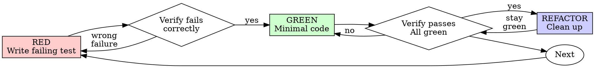

# Test-Driven Development (TDD)

## Overview

Write the test first. Watch it fail. Write minimal code to pass.

**Core principle:** Prove tests detect the intended failure; do not write
tests merely to satisfy a process. Choose the necessary coverage first.

## Choose the Test Before the Cycle

Read [writing-good-tests.md](writing-good-tests.md) before choosing tests.
Name the observable failure this change could introduce, then check whether
an existing test already catches it. Inspect its inputs and assertions; a
green suite alone does not prove the changed path is covered. Extend it instead
of adding another test for the same risk.

Use red-green-refactor for new behavior and bug regressions. Do not create
new tests for data-only enum entries, literal configuration, trivial
forwarding, generated output, or prose when existing behavior checks or
validation already cover the change. No permission ritual is needed for
these cases; report what you verified and any real coverage gap.

A constant can be part of an external contract (wire values, exported CSV
columns, persisted states). Test the observable contract at its boundary,
not that the source repeats the same literal. Security, money, data loss,
and plausible boundary failures deserve tests even in tiny diffs.

Prefer one focused scenario with related assertions to many tests that
repeat setup. There is no test-count, function-count, or coverage quota.
Do not delete working code merely because it predates a test: demonstrate
that the regression test detects the old behavior, or use a temporary,
reversible mutation and restore only your own mutation before finishing.
Preserve pre-existing edits; use an isolated worktree when needed.

Before a behavior-preserving refactor, identify coverage for the behavior
being preserved. Add focused characterization only for material gaps; do not
create a test for each extracted helper.

## Red-Green-Refactor



### RED - Write Failing Test

Write one minimal test showing what should happen.

<Good>
```typescript
test('retries failed operations 3 times', async () => {
  let attempts = 0;
  const operation = () => {
    attempts++;
    if (attempts < 3) throw new Error('fail');
    return 'success';
  };

  const result = await retryOperation(operation);

  expect(result).toBe('success');
  expect(attempts).toBe(3);
});
```
Clear name, tests real behavior, one thing
</Good>

<Bad>
```typescript
test('retry works', async () => {
  const operation = jest.fn().mockResolvedValue('success');
  expect(await operation()).toBe('success');
});
```
Only exercises the configured stub; never invokes retryOperation
</Bad>

**Requirements:**
- One behavior
- Clear name
- Production entry point; doubles only at meaningful boundaries

### Verify RED - Watch It Fail

**When the red-green cycle applies, observing RED is mandatory.**

```bash
npm test path/to/test.test.ts
```

Confirm:
- Test fails (not errors)
- Failure message is expected
- Fails because feature missing (not typos)

**New regression passes before the fix?** It has not reproduced the bug.
Correct the scenario or assertion until it fails for the relevant reason;
if reproduction is blocked, report that limit. This does not require making
existing behavior-preserving checks fail.

**Test errors?** Fix error, re-run until it fails correctly.

### GREEN - Minimal Code

Write simplest code to pass the test.

<Good>
```typescript
async function retryOperation<T>(fn: () => Promise<T>): Promise<T> {
  for (let i = 0; i < 3; i++) {
    try {
      return await fn();
    } catch (e) {
      if (i === 2) throw e;
    }
  }
  throw new Error('unreachable');
}
```
Just enough to pass
</Good>

<Bad>
```typescript
async function retryOperation<T>(
  fn: () => Promise<T>,
  options?: {
    maxRetries?: number;
    backoff?: 'linear' | 'exponential';
    onRetry?: (attempt: number) => void;
  }
): Promise<T> {
  // YAGNI
}
```
Over-engineered
</Bad>

Don't add features, refactor other code, or "improve" beyond the test.

### Verify GREEN - Watch It Pass

**MANDATORY.**

```bash
npm test path/to/test.test.ts
```

Confirm:
- Test passes
- Other tests still pass
- Output pristine (no errors, warnings)

**Test fails?** Fix code, not test.

**Other tests fail?** Fix now.

**"Other tests" means the project's suite, not just your file.** A
green run of the test you wrote is not a green suite. Before you call
the change done, run the project's test command (bare `pytest`,
`npm test`, `cargo test` — whatever the repo uses) even when your task
named only one test file. A scope statement in your task bounds the
deliverable, not your verification. Any failure that run shows —
including one you didn't cause — goes in your report by name; a red
test you watched scroll past and didn't mention is a report falsified
by omission.

### REFACTOR - Clean Up

After green only:
- Remove duplication
- Improve names
- Extract helpers

Keep tests green. Don't add behavior.

### Repeat

Next failing test for next feature.

## Good Tests

| Quality | Good | Bad |
|---------|------|-----|
| **Minimal** | One scenario; keep related outcome assertions together. | `test('validates email and domain and whitespace')` |
| **Clear** | Name describes behavior | `test('test1')` |
| **Shows intent** | Demonstrates desired API | Obscures what code should do |

When writing or changing any test, read [writing-good-tests.md](writing-good-tests.md) for the rules that keep tests honest:
- Name the production change that would make the test fail — before writing it
- Assert on real behavior, never on mock behavior
- Keep test-only code in test utilities, out of production classes
- Understand a dependency's side effects before mocking it

## Avoid False Confidence

- A green test is not evidence it catches the bug: observe the relevant
  failure before the fix, or verify it against the old behavior.
- A test that only repeats a constant or enum definition adds maintenance,
  not confidence. Exercise the consumer instead, if it has an uncovered risk.
- Do not skip a real regression because the fix is small or the deadline is
  short. Keep the regression narrow rather than broadening the test suite.

## Example: Bug Fix

**Bug:** Empty email accepted

**RED**
```typescript
test('rejects empty email', async () => {
  const result = await submitForm({ email: '' });
  expect(result.error).toBe('Email required');
});
```

**Verify RED**
```bash
$ npm test
FAIL: expected 'Email required', got undefined
```

**GREEN**
```typescript
function submitForm(data: FormData) {
  if (!data.email?.trim()) {
    return { error: 'Email required' };
  }
  // ...
}
```

**Verify GREEN**
```bash
$ npm test
PASS
```

**REFACTOR**
Extract validation for multiple fields if needed.

## Verification Checklist

Before marking work complete:

- [ ] Changed behavior and realistic regressions are covered without duplicate tests
- [ ] Each new regression demonstrated the relevant failure before the fix or against old behavior
- [ ] Each test failed for expected reason (feature missing, not typo)
- [ ] Wrote minimal code to pass each test
- [ ] All tests pass
- [ ] Output pristine (no errors, warnings)
- [ ] Tests exercise production behavior; doubles isolate appropriate boundaries
- [ ] Plausible boundary and error failures covered

Report any unchecked item honestly; fix material coverage gaps, not paperwork.

## When Stuck

| Problem | Solution |
|---------|----------|
| Don't know how to test | Write wished-for API. Write assertion first. Ask your human partner. |
| Test too complicated | Design too complicated. Simplify interface. |
| Must mock everything | Code too coupled. Use dependency injection. |
| Test setup huge | Extract helpers. Still complex? Simplify design. |

## Debugging Integration

Bug found? Write failing test reproducing it. Follow TDD cycle. Test proves fix and prevents regression.

Add a focused regression where feasible; report a concrete verification limit rather than manufacturing a low-value test.

## Final Rule

Every new test must catch a meaningful failure that existing tests miss.
Every changed behavior needs appropriate evidence, not necessarily a new test.
